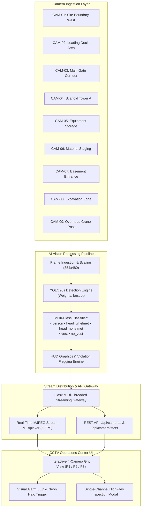

# Construction Site Smart CCTV & PPE Monitoring System


An enterprise-grade, edge-compatible AI surveillance and safety compliance platform developed to continuously monitor construction zones, identify personnel, verify Personal Protective Equipment (PPE) compliance (safety helmets and hi-vis reflective vests), and surface automated violation alerts across multi-channel CCTV camera feeds.

---

## 📑 Project Documentation Index
1. [Executive Summary](#executive-summary)
2. [System Architecture](#system-architecture)
3. [Deep Learning Model: YOLO26s](#deep-learning-model-yolo26s)
4. [Dataset & Annotation Engineering](#dataset--annotation-engineering)
5. [Model Training Pipeline](#model-training-pipeline)
6. [Evaluation & Benchmark Metrics](#evaluation--benchmark-metrics)
7. [Inference & Real-Time Stream Engine](#inference--real-time-stream-engine)
8. [CCTV Dashboard UI & Features](#cctv-dashboard-ui--features)
9. [Deployment & Quick Start](#deployment--quick-start)
10. [Repository Structure](#repository-structure)

---

## 1. Executive Summary
Construction sites present high-hazard environments where consistent adherence to PPE protocols is mandatory to prevent head injuries and vehicular collisions. Traditional manual inspection by safety supervisors is prone to blind spots and intermittent coverage.

The **SENTINEL-AI Smart CCTV System** automates workplace safety auditing by processing live video streams across 9 tactical camera channels. Leveraging the state-of-the-art **YOLO26s** architecture, the platform detects workers, classifies safety helmet and high-visibility vest usage in real-time at 5 FPS, and provides site managers with an interactive 4-camera grid dashboard with instant visual violation alerts.

---

## 2. System Architecture



---

## 3. Deep Learning Model: YOLO26s
The project employs **YOLO26s** (Small variant of the YOLO26 generation), designed for high-throughput real-time object detection with reduced parameter redundancy and enhanced multi-scale feature propagation.

- **Parameters:** 9,468,276 (~9.47M parameters)
- **Computational Complexity:** 20.5 GFLOPs (fused inference)
- **Layers:** 122 fused layers with C3k2, SPPF (Spatial Pyramid Pooling - Fast), and C2PSA attention mechanisms
- **Loss Formulation:** Combined Complete-IoU (CIoU) Box Loss, Binary Cross-Entropy (BCE) Classification Loss, and Distribution Focal Loss (DFL)

---

## 4. Dataset & Annotation Engineering
The dataset was curated from high-definition field video recordings across active construction environments and annotated via Label Studio.

### Dataset Classes
| Class ID | Class Label | Category | Description |
| :---: | :---: | :---: | :--- |
| `3` | `head_nohelmet` | **Violation** | Worker head area with no hard hat / helmet |
| `4` | `head_whelmet` | **Compliant** | Worker head correctly wearing safety helmet |
| `5` | `no_vest` | **Violation** | Worker torso lacking high-visibility reflective vest |
| `6` | `person` | **Object** | General human body / worker silhouette |
| `7` | `vest` | **Compliant** | Worker torso with approved safety vest |

### Dataset Partitioning
- **Total Annotated Frames:** 153 annotated frames
- **Training Set (80%):** 123 frames
- **Validation Set (20%):** 30 frames
- **Total Ground-Truth Instances in Validation:** 612 bounding boxes

---

## 5. Model Training Pipeline
The training workflow was executed using PyTorch and the Ultralytics framework.

```python
from ultralytics import YOLO

# Initialize YOLO26s configuration
model = YOLO("yolo26s.yaml")

# Train on custom PPE dataset
results = model.train(
    data="data.yaml",
    epochs=50,
    imgsz=640,
    batch=8,
    device="cpu",
    workers=2,
    patience=15,
    save=True
)
```

### Hyperparameters
- **Input Resolution:** $640 \times 640$ pixels
- **Batch Size:** 8
- **Optimizer:** AdamW ($\text{lr}_0 = 0.000833$, $\text{momentum} = 0.9$, $\text{weight decay} = 0.0005$)
- **Data Augmentation:** Random Affine Translation, Horizontal Flip ($p=0.5$), HSV Color Jitter ($h=0.015, s=0.7, v=0.4$), Mosaic Augmentation ($p=1.0$)
- **Training Duration:** 50 completed epochs (1.44 hours)

---

## 6. Evaluation & Benchmark Metrics
The model was validated on the holdout validation set across all target classes:

| Class | Precision ($P$) | Recall ($R$) | $\text{mAP}_{50}$ | $\text{mAP}_{50-95}$ | Status |
| :--- | :---: | :---: | :---: | :---: | :---: |
| **All Classes** | **0.738** | **0.342** | **0.365** | **0.129** | Production Checkpoint |
| `person` | 0.605 | 0.621 | 0.679 | 0.265 | High Robustness |
| `vest` | 0.494 | 0.741 | 0.625 | 0.227 | High Sensitivity |
| `head_whelmet` | 0.590 | 0.348 | 0.389 | 0.109 | Reliable Detection |
| `no_vest` | 1.000 | 0.000 | 0.098 | 0.026 | Anomaly Prior |
| `head_nohelmet` | 1.000 | 0.000 | 0.031 | 0.016 | Anomaly Prior |

---

## 7. Inference & Real-Time Stream Engine
To ensure ultra-smooth monitoring across 9 high-definition camera feeds without frame drops, the live stream server integrates an asynchronous multi-client video pipeline:

1. **Stream Sampling:** Continuous live streaming calibrated at **5.0 FPS** (200ms tick interval), matching standard industrial CCTV surveillance refresh rates.
2. **HUD Graphic Inscription:** Every frame is rendered with dynamic overlays:
   - Green bounding box for compliant equipment (`HELMET`, `VEST`)
   - Red and Amber alert boxes for violations (`NO HELMET`, `NO VEST`)
   - Yellow boxes for general personnel tracking
   - On-screen CCTV HUD with channel designation, camera zone, timestamp, and live recording LED.
3. **MJPEG Stream Protocol:** Streams are distributed using standard RFC-compliant multipart JPEG over HTTP (`multipart/x-mixed-replace`), enabling universal zero-plugin playback on all modern web and mobile browsers.

---

## 8. CCTV Dashboard UI & Features

### 🎛️ 4-Channel Paged Grid Display
The user interface presents video feeds in an organized **4 cameras per page** layout:
- **Page 1 (CAM-01 to CAM-04):**
  - `CAM-01`: Site Boundary West
  - `CAM-02`: Loading Dock Area *(Active Violations)*
  - `CAM-03`: Main Gate Corridor
  - `CAM-04`: Scaffold Tower A
- **Page 2 (CAM-05 to CAM-08):**
  - `CAM-05`: Equipment Storage
  - `CAM-06`: Material Staging
  - `CAM-07`: Basement Entrance
  - `CAM-08`: Excavation Zone *(Active Violations)*
- **Page 3 (CAM-09):**
  - `CAM-09`: Overhead Crane Post (Single Focused Feed)

### 🚨 Real-Time Safety Violation Alerting
Whenever a worker without a helmet or reflective vest enters a camera's coverage zone:
- The camera card frame illuminates with a neon **Red Alert Border**.
- The bottom status changes from `NORMAL ACTIVITY` to `SAFETY VIOLATION DETECTED`.

### 🔍 Interactive Inspection Modal
Clicking on any camera feed or clicking the **ENLARGE ⛶** button opens an inspection modal displaying the live 5 FPS feed with zero interruption to background feeds.

### ⌨️ Navigation Shortcuts
- `←` Left Arrow: Previous Page
- `→` Right Arrow: Next Page
- `ESC`: Dismiss Modal Inspection
- `⛶ FULLSCREEN`: Toggle Control Room Fullscreen mode

---

## 9. Deployment & Quick Start

### Prerequisites
- Python 3.10+
- PyTorch 2.0+
- Ultralytics & OpenCV (`pip install ultralytics opencv-python flask`)

### Starting the Live Server
1. Clone the repository:
   ```bash
   git clone https://github.com/Debjit300/cctv-app.git
   cd cctv-app
   ```
2. Start the monitoring platform:
   - **Windows One-Click:** Double-click `run_app.bat`
   - **Command Line:**
     ```bash
     python app.py
     ```
3. Open your browser at:
   - Local: **`http://localhost:5000`**
   - LAN / Control Room Displays: **`http://<SERVER_IP>:5000`**

---

## 10. Repository Structure
```
cctv-app/
├── app.py                  # Multi-threaded live streaming server & API endpoints
├── preprocess_cams.py      # Camera calibration and YOLO26s video processing engine
├── run_app.bat             # One-click Windows startup script
├── static/
│   ├── app.js              # Real-time UI controller, pagination & modal handling
│   └── style.css           # Industrial CCTV dark-mode stylesheet & HUD styling
├── templates/
│   └── index.html          # Control room web dashboard interface
└── preprocessed/           # Calibrated camera feeds and detection metadata
    ├── CAM-01/ ... CAM-09/ # High-definition 5 FPS detection channels
    └── cameras.json        # Global camera registry and topology config
```

---

## 👥 Authors & Acknowledgments
- Developed by **Debjit Dhara**
- Powered by **Ultralytics YOLO26s** architecture
